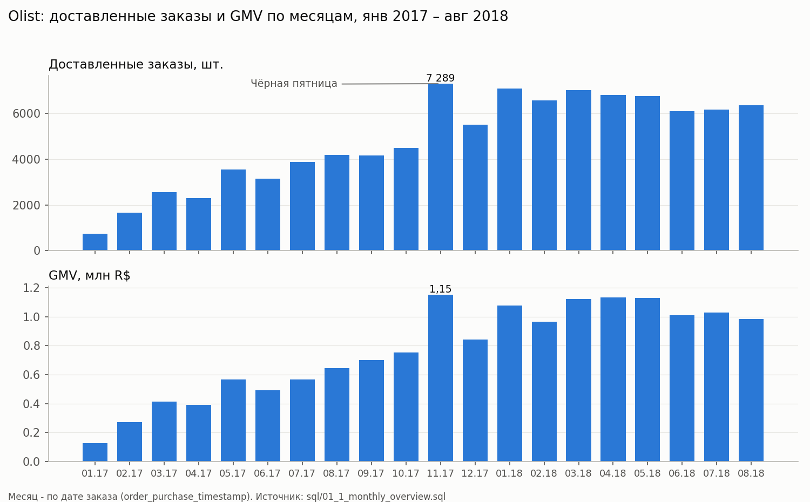
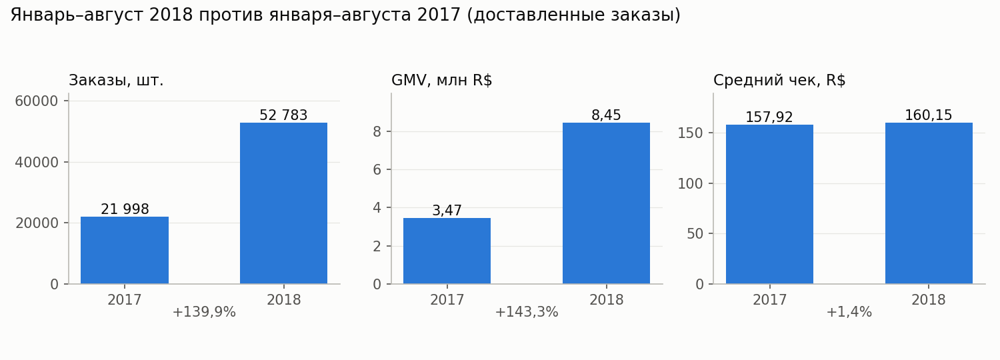

# Задача 1. «Как у нас дела в целом?»

> **Письмо продакта.** Выручка, число заказов и средний чек по месяцам. Растём или нет? Есть ли месяцы, которые выбиваются, и почему? Если что-то в данных выглядит странно — скажи, это тоже результат.

## Определения
| Что | Как считаю | Почему |
|---|---|---|
| Выручка | **GMV** — сумма `payments.payment_value` | Это всё, что фактически заплатил покупатель, включая доставку и проценты по рассрочке. Комиссии маркетплейса в данных нет |
| Заказы | только `delivered` (≈96% заказов) | Остальные статусы — отмены и заказы, которые так и не доехали; это не заработанные деньги. Показаны отдельно |
| Месяц | по `order_purchase_timestamp` | Момент, когда покупатель решил купить; пропусков нет |
| Средний чек | GMV доставленных / число доставленных | Один набор заказов в числителе и знаменателе |
| Период | январь 2017 – август 2018 | В 2016 году — единичные заказы, после августа 2018 доставленных заказов нет (данные заканчиваются 17.10.2018) |

В `payments` бывает несколько строк на заказ (оплата картой и ваучерами). Двойного счёта нет: заказы считаются через `COUNT(DISTINCT order_id)`, GMV — как сумма всех платежей.

## Динамика по месяцам

Таблица по месяцам

| Месяц | Заказы | GMV, R$ | Средний чек, R$ | Недоставленные: заказы | Недоставленные: средний чек, R$ |
|---|---:|---:|---:|---:|---:|
| 2017-01 | 750 | 127 546 | 170,06 | 50 | 218,85 |
| 2017-02 | 1 653 | 271 299 | 164,13 | 127 | 162,28 |
| 2017-03 | 2 546 | 414 369 | 162,75 | 136 | 260,99 |
| 2017-04 | 2 303 | 390 952 | 169,76 | 101 | 265,70 |
| 2017-05 | 3 546 | 567 067 | 159,92 | 154 | 167,87 |
| 2017-06 | 3 135 | 490 226 | 156,37 | 110 | 191,37 |
| 2017-07 | 3 872 | 566 404 | 146,28 | 154 | 168,69 |
| 2017-08 | 4 193 | 646 000 | 154,07 | 138 | 205,77 |
| 2017-09 | 4 150 | 701 170 | 168,96 | 135 | 196,98 |
| 2017-10 | 4 478 | 751 140 | 167,74 | 153 | 186,52 |
| 2017-11 | 7 289 | 1 153 530 | 158,26 | 255 | 162,18 |
| 2017-12 | 5 513 | 843 199 | 152,95 | 160 | 220,01 |
| 2018-01 | 7 069 | 1 078 610 | 152,58 | 200 | 181,99 |
| 2018-02 | 6 555 | 966 511 | 147,45 | 173 | 150,01 |
| 2018-03 | 7 003 | 1 120 680 | 160,03 | 208 | 187,38 |
| 2018-04 | 6 798 | 1 132 930 | 166,66 | 141 | 197,53 |
| 2018-05 | 6 749 | 1 128 840 | 167,26 | 124 | 202,79 |
| 2018-06 | 6 099 | 1 012 090 | 165,94 | 68 | 173,38 |
| 2018-07 | 6 159 | 1 027 900 | 166,89 | 133 | 290,50 |
| 2018-08 | 6 351 | 985 414 | 155,16 | 161 | 229,88 |

## Выводы
1. **Растём.** Январь–август 2018 к январю–августу 2017: заказы 21 998 → 52 783 (**+139,9%**), GMV 3,47 → 8,45 млн R$ (**+143,3%**).
2. **Рост — за счёт числа заказов, а не чека.** Средний чек почти не изменился: 157,92 → 160,15 R$ (**+1,4%**).
3. **В 2018 году рост от месяца к месяцу почти остановился:** заказы держатся на уровне ~6–7 тыс. в месяц.
4. **Ноябрь 2017 — пик из-за Чёрной пятницы.** 24.11.2017 — 1 147 заказов против ~170 в обычный день (×6,7); до конца ноября — ~369 в день (×2,2).
5. **Странности в данных:** в 2016 году почти нет заказов (в ноябре — ни одного, в декабре — один); после августа 2018 нет доставленных заказов. Средний чек недоставленных и отменённых заказов почти во всех месяцах выше, чем у доставленных — стоит разобрать отдельно.

## Рекомендация
В 2018 году рост встал на ~6–7 тыс. заказов в месяц. Рекомендую разложить рост на составляющие, чтобы понять, что именно его даёт:

**GMV = покупатели (новые + вернувшиеся) × заказы на покупателя × средний чек**

Средний чек почти не меняется, поэтому дальше стоит проверить, живём ли мы за счёт первых заказов новых покупателей или за счёт повторных заказов.

→ Проверено в [задаче 2](task2.md): почти весь GMV дают первые покупки новых покупателей — повторно покупают только 2,13%.

## SQL
| Файл | Что делает |
|---|---|
| [`01_0_views.sql`](../sql/01_0_views.sql) | Базовые VIEW: доставленные заказы по дням и месяцам без пропусков дат |
| [`01_1_monthly_overview.sql`](../sql/01_1_monthly_overview.sql) | Таблица по месяцам |
| [`01_2_not_delivered.sql`](../sql/01_2_not_delivered.sql) | Отменённые и недоставленные заказы |
| [`01_3_mom_yoy.sql`](../sql/01_3_mom_yoy.sql) | MoM и YoY по месяцам |
| [`01_4_jan_aug_2018_vs_2017.sql`](../sql/01_4_jan_aug_2018_vs_2017.sql) | Январь–август 2018 против 2017 |
| [`01_5_black_friday.sql`](../sql/01_5_black_friday.sql) | Проверка гипотезы о Чёрной пятнице |
